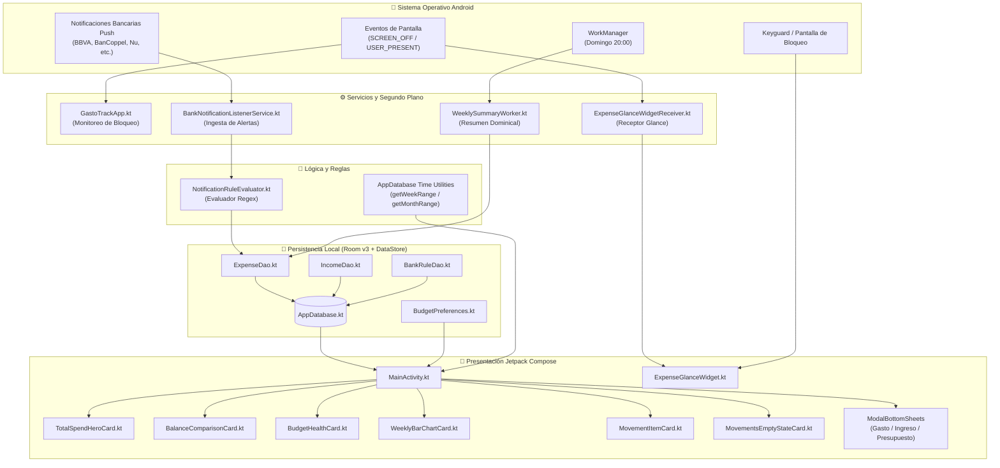

<div align="center">

# 💰 GastoTrack — Control Financiero Inteligente, Privado y Automatizado

[](https://github.com/Jac0b02/AhorroWid/releases/latest)
[](https://github.com/Jac0b02/AhorroWid/actions)
[](https://kotlinlang.org)
[-3DDC84.svg?logo=android&logoColor=white)](https://developer.android.com)
[](https://developer.android.com/jetpack/compose)
[](https://m3.material.io)
[-009688.svg)](https://developer.android.com/training/data-storage/room)
[](https://developer.android.com/jetpack/compose/glance)
[](LICENSE)

<br/>

**Control financiero personal, balance de ingresos, detección automática de compras con tarjeta y widgets adaptativos sin sacrificar tu privacidad.**

[📱 Descargar APK Directo](#-descarga-directa-del-apk) • [✨ Características](#-características-principales) • [🎨 Diseño Material 3](#-experiencia-de-usuario-y-diseño-material-3) • [📊 Widgets Glance](#-widget-de-pantalla-de-inicio-adaptativo-jetpack-glance)

</div>

---

> 🔒 **Filosofía 100% Local-First**: Todo el procesamiento, análisis y almacenamiento ocurre de forma exclusiva en la base de datos SQLite de tu dispositivo. **Sin servidores externos, sin suscripciones ocultas, sin recolección de datos ni telemetría.**

---

## 📥 Descarga Directa del APK

| Archivo | Versión | Estado | Enlace Directo |
|---|---|---|---|
| 📦 **GastoTrack-v1.1.0.apk** | **v1.1.0 (Build 2)** | ✅ Estable / Recomendada | [**Descargar v1.1.0 (.apk)**](https://github.com/Jac0b02/AhorroWid/releases/download/v1.1.0/GastoTrack-v1.1.0.apk) |
| 🚀 **GastoTrack-latest.apk** | **Última Compilación** | 🔄 Automática CI/CD | [**Descargar Última Versión**](https://github.com/Jac0b02/AhorroWid/releases/latest/download/GastoTrack-latest.apk) |

> 💡 **Nota de instalación**: Al ser un APK directo de GitHub, tu teléfono Android podría pedirte confirmación para *"Instalar aplicaciones de fuentes desconocidas"*. Es 100% seguro y de código abierto.

### 💡 ¿Por qué elegir GastoTrack frente a otras apps?

| Característica | 💰 GastoTrack | 🏦 Otras Apps Financieras |
|---|---|---|
| **Privacidad** | 🔒 **100% Local (SQLite)** — Jamás sale de tu móvil | ☁️ Envían tus datos a servidores externos |
| **Detección Bancaria** | ⚡ **Pasiva desde Notificaciones** — Sin credenciales bancarias | 🔑 Te piden usuario y contraseña de tu banco |
| **Registro de Efectivo** | ⏱️ **1 Toque** desde Widgets adaptativos en tu pantalla de inicio | 🐢 Formularios lentos y menús escondidos |
| **Costo y Publicidad** | 🆓 **100% Gratis, Código Abierto y Cero Anuncios** | 💳 Suscripciones mensuales caras ($5 - $10 USD/mes) |
| **Diseño y Ergonomía** | 🎨 **Google Pixel / Material 3**, BottomSheets y háptica | 📱 Diseños genéricos desactualizados |

---

## 📑 Tabla de Contenidos

1. [Características Principales](#-características-principales)
2. [Experiencia de Usuario y Diseño (Material 3)](#-experiencia-de-usuario-y-diseño-material-3)
3. [Widget de Pantalla de Inicio Adaptativo (Jetpack Glance)](#-widget-de-pantalla-de-inicio-adaptativo-jetpack-glance)
4. [Arquitectura del Sistema](#-arquitectura-del-sistema)
5. [Estructura del Proyecto](#-estructura-del-proyecto)
6. [Persistencia y Base de Datos (Room)](#-persistencia-y-base-de-datos-room)
7. [Detección de Notificaciones Bancarias](#-detección-de-notificaciones-bancarias)
8. [Compilación e Instalación](#-compilación-e-instalación)
9. [Configuración Inicial Recomendada](#-configuración-inicial-recomendada)
10. [Licencia](#-licencia)

---

## 🌟 Características Principales

### 💳 1. Ingesta Automática de Gastos Bancarios
- **Escucha pasiva en segundo plano**: Procesamiento de notificaciones en tiempo real a través de `NotificationListenerService`.
- **Compatibilidad nativa con bancos de México**: Soporte integrado para **BBVA**, **BanCoppel**, **Nu (Nubank)**, **Santander**, **Banorte**, **Mercado Pago** y extensible a cualquier entidad.
- **Motor de Reglas Inteligente**: Filtra palabras clave positivas (`compra`, `cargo`, `retiro`), ignora falsos positivos (`depósito`, `abono`, `código OTP`, `cajita`) y extrae automáticamente el monto y el nombre del comercio.
- **Sandbox Bancario**: Área de pruebas interactiva en la app para verificar expresiones regulares con notificaciones simuladas sin gastar dinero real.

### 💵 2. Registro Rápido de Efectivo en 1 Toque
- Botones dinámicos de gastos habituales calculados según la frecuencia de uso en los últimos 30 días (*Café*, *Comida*, *Transporte*).
- Formulario ergonómico en **Modal BottomSheet** con teclado numérico numPad, accesos rápidos de incremento (`+$10`, `+$50`, `+$100`, `+$500`) y prevención de oclusión con teclado `imePadding()`.

### ⚖️ 3. Balance Neto: Ganancias vs. Pérdidas
- Tarjeta de balance consolidado en tiempo real (**Superávit** en verde esmeralda o **Déficit** en rojo coral).
- Indicador visual del dinero disponible en el período seleccionado.
- Registro rápido de ingresos extraordinarios o recurrentes (sueldo, transferencias, ventas).

### 🎯 4. Presupuesto Semanal y Mensual con Semáforo de Salud
- Metas de presupuesto configurables persistidas en **Jetpack DataStore Preferences**.
- Barra de progreso y semáforo visual adaptativo:
  - 🟢 **Verde (< 75%)**: Finanzas en orden y gasto moderado.
  - 🟡 **Amarillo (75% - 90%)**: Precaución y atención al ritmo de gasto.
  - 🟠 **Naranja (90% - 100%)**: Próximo al límite presupuestal.
  - 🔴 **Rojo (> 100%)**: Presupuesto excedido.

### 📊 5. Gráfico Interactivo de Barras Dobles
- Comparativa visual diaria de **Ingresos vs. Gastos**:
  - **Modo Semanal**: 7 columnas de Lunes a Domingo con indicador del día actual (*Hoy*), balance neto del día y selector táctil.
  - **Modo Mensual**: Desglose consolidado por semanas del mes.

### 🗓️ 6. Navegación Histórica Bidireccional
- Selector de períodos con botones `[ < ]` y `[ > ]` para consultar semanas o meses anteriores.
- Botón contextual animado **"Hoy"** para regresar inmediatamente al período actual con un solo toque.

---

## 🎨 Experiencia de Usuario y Diseño (Material 3)

La interfaz se rige bajo las directrices de **Google Material 3 / Pixel Aesthetics**:

- **Tokens Semánticos Financieros**: Paleta calibrada para alto contraste (accesibilidad WCAG AA/AAA) con `financialColors.income` (verde esmeralda), `financialColors.expense` (rojo/coral) y estados de advertencia.
- **Ergonomía de Una Sola Mano (BottomSheets)**: Eliminación de cuadros de diálogo centrados clásicos en favor de `ModalBottomSheet` con bordes redondeados (28dp), soporte para teclado virtual (`imePadding`) y gestos de deslizamiento.
- **Micro-interacciones y Háptica**: Respuesta táctil sutil en cada registro, eliminación y navegación de pantallas.
- **Empty States Interactivos**: Cuando no hay transacciones en el filtro activo, la app ofrece ilustraciones tonales y botones directos de acción rápida (`+ Gasto`, `+ Ingreso`).
- **Sistema de Cuadrícula de 8dp**: Espaciados armoniosos, hitboxes accesibles de mínimo 48x48dp y bordes con acabado `outlineVariant` al 35% de opacidad.

---

## 📱 Widget de Pantalla de Inicio Adaptativo (Jetpack Glance)

Construido con **Jetpack Glance 1.1.1**, el widget se conecta reactivamente al `Flow` de Room y se redimensiona orgánicamente sin cortar textos:

### Formatos Adaptativos:

#### 1. Formato Horizontal Delgado (4x1 / 3x1 celdas)
```text
┌────────────────────────────────────────────────────────────────────────┐
│  Semana: $ 1,450   │  [ +$50 Café ]  [ +$73 Comida ]  [ +$100 Transp ] [ + Otro ] │
└────────────────────────────────────────────────────────────────────────┘
```
*Aprovecha todo el ancho en una sola fila continua; los botones conservan su altura completa sin comprimirse.*

#### 2. Formato Cuadrado Estándar (2x2 celdas)
```text
┌──────────────────────────────────────┐
│  Total: $ 1,450.00         Semana    │
├──────────────────────────────────────┤
│  [ +$50 Café ]      [ +$73 Comida ]  │
│  [ +$100 Transp ]   [    + Otro   ]  │
└──────────────────────────────────────┘
```

#### 3. Formato Expandido (4x2 / 4x4 celdas)
```text
┌────────────────────────────────────────────────────────────────────────┐
│  Total Semanal: $ 1,450.00          │  [ +$50 Café ]      [ +$73 Comida ]  │
│  💳 Tarjeta: $ 950.00               │  [ +$100 Transp ]   [    + Otro   ]  │
│  💵 Efectivo: $ 500.00              │                                      │
└────────────────────────────────────────────────────────────────────────┘
```

### 🔒 Blindaje de Privacidad en Pantalla de Bloqueo
El widget detecta automáticamente si el dispositivo está bloqueado mediante `KeyguardManager`:
- Las cifras monetarias se censuran mostrando `$ ••••`, `💳 ••••` y `💵 ••••` para evitar miradas indiscretas.
- **Los botones rápidos de gasto permanecen 100% funcionales**: Puedes registrar un café o transporte en 1 segundo desde la pantalla de bloqueo sin necesidad de desbloquear el teléfono. Al desbloquearse, los montos reales reaparecen de inmediato.

---

## 🧠 Arquitectura del Sistema



---

## 📂 Estructura del Proyecto

```text
GastoTrack_Android_ReadyToBuild/
├── app/
│   ├── build.gradle.kts                        # Dependencias (Compose, Room, Glance, WorkManager)
│   ├── schemas/                                # Esquemas históricos exportados de Room (v1, v2, v3)
│   └── src/
│       ├── main/
│       │   ├── AndroidManifest.xml             # Permisos (Notification Listener, Post Notifications)
│       │   ├── java/com/gastotrack/app/
│       │   │   ├── GastoTrackApp.kt            # Application global y listeners de estado de pantalla
│       │   │   ├── data/local/
│       │   │   │   ├── AppDatabase.kt          # Base de datos Room v3 con migraciones seguras
│       │   │   │   ├── BudgetPreferences.kt    # DataStore reactivo para presupuestos
│       │   │   │   ├── dao/
│       │   │   │   │   ├── BankRuleDao.kt      # DAO de reglas bancarias regex
│       │   │   │   │   ├── ExpenseDao.kt       # DAO de gastos con consultas por rango temporal
│       │   │   │   │   └── IncomeDao.kt        # DAO de ingresos y balances
│       │   │   │   └── entities/
│       │   │   │       ├── BankRuleEntity.kt   # Entidad de reglas de notificación
│       │   │   │       ├── ExpenseEntity.kt    # Entidad de gastos
│       │   │   │       └── IncomeEntity.kt     # Entidad de ingresos
│       │   │   ├── service/
│       │   │   │   ├── BankNotificationListenerService.kt # Detección y parseo de notificaciones
│       │   │   │   └── NotificationRuleEvaluator.kt       # Motor de regex y filtros bancarios
│       │   │   ├── ui/
│       │   │   │   ├── MainActivity.kt         # Actividad principal con Scaffold y navegación
│       │   │   │   ├── dashboard/
│       │   │   │   │   ├── BalanceComparisonCard.kt       # Tarjeta de balance neto consolidado
│       │   │   │   │   ├── BudgetBottomSheet.kt           # BottomSheet ergonómico de metas
│       │   │   │   │   ├── BudgetHealthCard.kt            # Semáforo de salud presupuestal
│       │   │   │   │   ├── DashboardModels.kt             # Modelos de presentación UI
│       │   │   │   │   ├── MovementItemCard.kt            # Tarjeta de movimiento con insignia de método
│       │   │   │   │   ├── MovementsEmptyStateCard.kt     # Estado vacío interactivo con CTAs
│       │   │   │   │   ├── PeriodSelector.kt              # Selector temporal (< Período >)
│       │   │   │   │   ├── QuickCashEntryBottomSheet.kt   # BottomSheet de registro en efectivo
│       │   │   │   │   ├── QuickIncomeEntryBottomSheet.kt # BottomSheet de registro de ingresos
│       │   │   │   │   ├── TotalSpendHeroCard.kt          # Hero card de gasto total tarjeta/efectivo
│       │   │   │   │   └── WeeklyBarChartCard.kt          # Gráfico de barras dobles interactivo
│       │   │   │   ├── settings/
│       │   │   │   │   └── SettingsScreen.kt              # Sandbox bancario y configuración
│       │   │   │   └── theme/                             # Tokens Material 3, colores y formas
│       │   │   ├── widget/
│       │   │   │   ├── ExpenseGlanceWidget.kt             # Widget multi-tamaño adaptativo
│       │   │   │   └── QuickCashActionCallback.kt         # Callback háptico de registro desde widget
│       │   │   └── worker/
│       │   │       └── WeeklySummaryWorker.kt             # Resumen dominical automático
│       │   └── res/
│       │       └── xml/
│       │           └── expense_widget_info.xml            # Configuración de redimensionado Glance
│       └── test/java/com/gastotrack/app/                  # Pruebas unitarias de migraciones y evaluador
├── build.gradle.kts
└── settings.gradle.kts
```

---

## 💾 Persistencia y Base de Datos (Room)

El almacenamiento se realiza en SQLite mediante **Room**:
- **Versión 1**: Tabla `expenses` (gastos con origen tarjeta/efectivo, comercio, timestamp) y tabla `bank_rules` (reglas con regex y filtros).
- **Versión 2**: Incorporación de índices optimizados y soporte para frecuencias de efectivo.
- **Versión 3**: Incorporación de la tabla `incomes` para registrar ingresos y calcular balances netos y ahorros:
  ```sql
  CREATE TABLE IF NOT EXISTS `incomes` (
      `id` INTEGER PRIMARY KEY AUTOINCREMENT NOT NULL,
      `amount` REAL NOT NULL,
      `concept` TEXT NOT NULL,
      `source` TEXT NOT NULL,
      `category` TEXT NOT NULL DEFAULT 'General',
      `timestamp` INTEGER NOT NULL
  );
  ```
- Todas las migraciones cuentan con cobertura de pruebas unitarias en `DatabaseMigrationTest.kt` mediante `MigrationTestHelper`.

---

## 🏦 Detección de Notificaciones Bancarias

El motor de reglas en [`NotificationRuleEvaluator.kt`](file:///c:/Users/alexc/Downloads/GastoTrack_Android_ReadyToBuild/app/src/main/java/com/gastotrack/app/service/NotificationRuleEvaluator.kt) procesa el texto de cada notificación entrante:

1. **Filtro de Paquete / Título**: Verifica si pertenece a la app bancaria (ej. `com.bancomer.mbanking` o título `BBVA`).
2. **Palabras Clave Positivas**: Comprueba si describe un gasto o retiro (`compra`, `cargo`, `transferencia enviada`, `consumiste`).
3. **Palabras Clave Negativas**: Descarta alertas informativas o depósitos (`abono`, `recibiste`, `código`, `puntos`, `apartado`, `cajita`).
4. **Extracción de Monto**: Regex dinámico que soporta formatos como `$1,250.00`, `1250.00 MXN`, `$45.50`.
5. **Extracción de Comercio**: Identifica patrones como `en UBER EATS con tarjeta...` o `por MERCADO PAGO el 18/10`.
6. **Deduplicación Temporal**: Previene registrar dos veces el mismo gasto si el banco emite alertas repetidas en una ventana corta de segundos.

---

## 🛠️ Compilación e Instalación

### Requisitos Previos
- **Java JDK**: Versión 17 o superior.
- **Android SDK**: API 34 o 35 instalada.
- **Gradle**: El wrapper incluido (`./gradlew`) descarga la versión correcta automáticamente.

### Compilar e Instalar por Línea de Comandos (ADB)

Con tu teléfono conectado por cable USB y la depuración USB activa:

```bash
# 1. Ejecutar pruebas unitarias de verificación
./gradlew testDebugUnitTest

# 2. Compilar el APK en modo debug
./gradlew assembleDebug

# 3. Instalar en tu teléfono conectado
adb install -r app/build/outputs/apk/debug/app-debug.apk

# 4. Iniciar la aplicación
adb shell am start -n com.gastotrack.app/.ui.MainActivity
```

---

## ⚙️ Configuración Inicial Recomendada

Para aprovechar al 100% las capacidades automáticas en tu dispositivo Android:

1. **Permiso de Acceso a Notificaciones**:
   - Al abrir la app, si el servicio no está habilitado, pulsa el botón del banner o ve a **Ajustes de Android > Notificaciones > Acceso a notificaciones** y activa **GastoTrack**.
2. **Permiso de Notificaciones Push (Android 13+)**:
   - Acepta el permiso del sistema al iniciar para que la app pueda enviarte el resumen dominical.
3. **Añadir el Widget a tu Pantalla de Inicio**:
   - Mantén presionado un espacio vacío en tu pantalla de inicio, selecciona **Widgets**, busca **GastoTrack** y arrástralo.
   - Redimensiónalo a tu gusto: **4x1** para una barra horizontal limpia o **2x2** para un pad de registro rápido.
4. **Fijar tu Presupuesto**:
   - En la tarjeta **Salud del Presupuesto**, pulsa **Ajustar Meta** para definir tu presupuesto semanal y mensual.

---

## 📄 Licencia

Este proyecto está bajo la Licencia **MIT**. Consulta el archivo `LICENSE` para más información.

---

*Desarrollado con pasión para ofrecer control financiero personal, estética Google Pixel y privacidad absoluta.*
