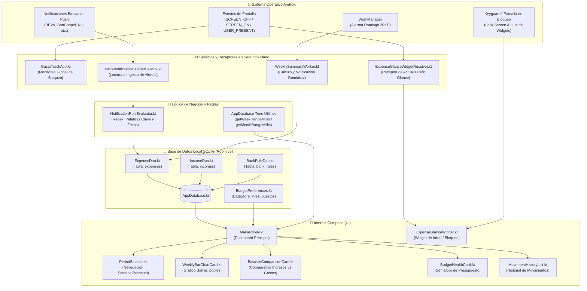

# 💰 GastoTrack (AhorroWid) — Control Financiero Inteligente y Privado para Android

[](https://kotlinlang.org)
[-green.svg?logo=android)](https://developer.android.com)
[](https://developer.android.com/jetpack/compose)
[](https://m3.material.io)
[-orange.svg)](https://developer.android.com/training/data-storage/room)
[](https://developer.android.com/jetpack/compose/glance)
[](LICENSE)

**GastoTrack** (también conocido como **AhorroWid**) es una aplicación nativa para Android diseñada con **Jetpack Compose** y los principios de diseño de **Google Pixel (Material You / Material 3)**. Su objetivo es brindar control financiero inmediato, balance de ingresos contra gastos, registro ultra rápido de efectivo y escucha automatizada de compras bancarias sin comprometer jamás la privacidad del usuario.

Todo el procesamiento ocurre **100% en el dispositivo (Local-First)**. No existen servidores externos, ni telemetría invasiva, ni almacenamiento en la nube no autorizado.

---

## 📥 Descarga Directa del APK (Instalación Rápida)

¿Solo quieres instalar la app en tu teléfono sin compilar nada?
Puedes descargar el instalador **APK** directamente desde la sección de **Releases** de este repositorio:

👉 **[Descargar la Última Versión de GastoTrack (.apk)](https://github.com/Jac0b02/AhorroWid/releases/latest)**

*En esa sección encontrarás el archivo `GastoTrack-v1.0.0.apk` listo para descargar y abrir directamente en tu dispositivo Android.*

---

## 📑 Tabla de Contenidos
1. [Descarga Directa](#-descarga-directa-del-apk-instalación-rápida)
2. [Características Principales](#-características-principales)
3. [Novedades Recientes](#-novedades-recientes)
3. [Arquitectura del Sistema](#-arquitectura-del-sistema)
4. [Estructura del Proyecto](#-estructura-del-proyecto)
5. [Widget de Pantalla de Inicio y Bloqueo (Glance)](#-widget-de-pantalla-de-inicio-y-bloqueo-glance)
6. [Persistencia y Base de Datos (Room v3)](#-persistencia-y-base-de-datos-room-v3)
7. [Detección de Notificaciones Bancarias](#-detección-de-notificaciones-bancarias)
8. [Compilación e Instalación](#-compilación-e-instalación)
9. [Configuración Inicial Recomendada](#-configuración-inicial-recomendada)
10. [Licencia y Contribución](#-licencia-y-contribución)

---

## 🌟 Características Principales

### 1. Ingesta Automática de Gastos Bancarios
- Escucha pasiva de notificaciones bancarias mediante `NotificationListenerService`.
- Soporte nativo para instituciones bancarias en México: **BBVA**, **BanCoppel**, **Nu (Nubank)** y motor extensible mediante reglas con expresiones regulares (Regex).
- Reglas configurables con palabras clave positivas (`compra`, `cargo`, `retiro`), palabras clave negativas para ignorar (`depósito`, `abono`, `código OTP`, `cajita`, `puntos`) y extracción automática del monto y comercio.
- Pestaña de **Sandbox Bancario** integrada en la app para simular notificaciones y probar reglas en vivo sin gastar dinero real.

### 2. Registro Rápido de Efectivo en 1 Toque
- Botón flotante para ingresos rápidos en efectivo.
- Barra de sugerencias frecuentes basadas en los gastos más habituales de los últimos 30 días (ej. *Café*, *Comida*, *Transporte*).
- Diálogo modal con teclado numérico limpio, botones de incremento rápido (`+$10`, `+$50`, `+$100`, `+$500`) y selector de categorías con iconografía dinámica.

### 3. Presupuesto Semanal y Mensual con Semáforo de Salud
- Configuración de metas de gasto semanal y mensual persistidas en Jetpack DataStore.
- Indicador visual tipo pill / barra de progreso que cambia dinámicamente de color:
  - 🟢 **Verde (< 75%)**: Gasto saludable.
  - 🟡 **Amarillo (75% - 90%)**: Atención y moderación.
  - 🟠 **Naranja (90% - 100%)**: Cerca del límite.
  - 🔴 **Rojo (> 100%)**: Presupuesto superado.

### 4. Notificaciones Inteligentes y Resumen Dominical
- `WeeklySummaryWorker` programado con Android WorkManager cada domingo a las 20:00.
- Generación automática de resumen semanal con balance neto, desglose tarjeta vs efectivo y comparación con el presupuesto asignado.

---

## 🚀 Novedades Recientes

### 🗓️ 1. Historial Navegable por Semanas y Meses Anteriores
- Navegación temporal bidireccional con controles `[ < ]` y `[ > ]` en la barra superior del selector de períodos.
- Capacidad para retroceder en el tiempo y consultar cómo fue el flujo de dinero en semanas pasadas o meses anteriores completos.
- Botón contextual animado **"Hoy"**: si navegas al pasado, aparece un botón rápido para volver instantáneamente a la semana o mes en curso.
- Bloqueo de avance a fechas futuras inexistentes para garantizar consistencia en las consultas.

### 📊 2. Gráfico de Barras Dobles (Ingresos vs. Gastos)
- Visualización lado a lado de dos barras por período:
  - 🟢 **Verde Esmeralda**: Total de ingresos recibidos.
  - 🔴 **Rojo Coral**: Total de gastos acumulados.
- **Vista Semanal**: 7 columnas (Lunes a Domingo) que muestran el comportamiento diario, indicador del día actual (*Hoy*), balance neto diario (`+$X` o `-$X`) y panel táctil interactivo para desglosar el detalle del día seleccionado.
- **Vista Mensual**: Agrupación por semanas del mes (Semana 1 a Semana 5) con acumulados comparativos.

### 🛡️ 3. Blindaje de Privacidad en Widgets (Pantalla de Bloqueo)
- El widget de escritorio y pantalla de bloqueo detecta si el dispositivo está bloqueado mediante `KeyguardManager`.
- **Censura selectiva inteligente**:
  - Si el teléfono está bloqueado o en el centro de widgets rápidos de la pantalla de bloqueo, las cifras monetarias acumuladas se censuran automáticamente mostrando `$ ••••`, `💳 ••••` y `💵 ••••`.
  - **Botones de acción rápida intactos**: Los botones de registro directo (`+$50 Café`, `+$73 Comida`, `+$100 Transporte` y `+ Otro`) se mantienen visibles y funcionales para que puedas apuntar un gasto en efectivo en 1 segundo sin desbloquear el teléfono.
  - En cuanto el dispositivo se desbloquea (`ACTION_USER_PRESENT`), el widget muestra inmediatamente los saldos reales actualizados.

---

## 🧠 Arquitectura del Sistema

El proyecto sigue una arquitectura desacoplada basada en Clean Architecture y componentes modernos de Android Jetpack:



---

## 📂 Estructura del Proyecto

```text
GastoTrack_Android_ReadyToBuild/
├── app/
│   ├── build.gradle.kts                        # Dependencias (Compose, Room, Glance, WorkManager)
│   ├── schemas/                                # Esquemas históricos exportados de Room (v1, v2, v3)
│   └── src/
│       ├── main/
│       │   ├── AndroidManifest.xml             # Permisos (Notification Listener, Post Notifications)
│       │   ├── java/com/gastotrack/app/
│       │   │   ├── GastoTrackApp.kt            # Aplicación global con receptor dinámico de pantalla
│       │   │   ├── data/local/
│       │   │   │   ├── AppDatabase.kt          # Base de datos Room v3, migraciones MIGRATION_1_2 y 2_3
│       │   │   │   ├── BudgetPreferences.kt    # DataStore para presupuestos semanal y mensual
│       │   │   │   ├── dao/
│       │   │   │   │   ├── BankRuleDao.kt      # DAO de reglas bancarias
│       │   │   │   │   ├── ExpenseDao.kt       # DAO de gastos con consultas por rango temporal
│       │   │   │   │   └── IncomeDao.kt        # DAO de ingresos con balance y rangos
│       │   │   │   └── entities/
│       │   │   │       ├── BankRuleEntity.kt   # Entidad de regla bancaria
│       │   │   │       ├── ExpenseEntity.kt    # Entidad de gasto (monto, concepto, origen, tarjeta)
│       │   │   │       └── IncomeEntity.kt     # Entidad de ingreso (monto, concepto, timestamp)
│       │   │   ├── service/
│       │   │   │   ├── BankNotificationListenerService.kt # Servicio de escucha y parseo de alertas
│       │   │   │   ├── NotificationRuleEvaluator.kt       # Evaluador regex y palabras clave
│       │   │   │   └── WeeklySummaryWorker.kt             # Worker dominical de resumen
│       │   │   ├── ui/
│       │   │   │   ├── MainActivity.kt         # Actividad principal con Scaffold y navegación
│       │   │   │   ├── dashboard/
│       │   │   │   │   ├── BalanceComparisonCard.kt   # Tarjeta de balance neto (Ingreso vs Gasto)
│       │   │   │   │   ├── BudgetHealthCard.kt        # Tarjeta de salud presupuestal
│       │   │   │   │   ├── DashboardModels.kt         # Modelos de datos para el dashboard y gráficos
│       │   │   │   │   ├── MovementHistoryList.kt     # Lista de transacciones con eliminación
│       │   │   │   │   ├── PeriodSelector.kt          # Barra de navegación temporal (< Período >)
│       │   │   │   │   ├── QuickCashEntryDialog.kt    # Modal de registro rápido de gasto
│       │   │   │   │   ├── QuickIncomeEntryDialog.kt  # Modal de registro rápido de ingreso
│       │   │   │   │   └── WeeklyBarChartCard.kt      # Gráfico de barras dobles lado a lado
│       │   │   │   ├── settings/
│       │   │   │   │   └── SettingsScreen.kt          # Pantalla de reglas bancarias y sandbox
│       │   │   │   └── theme/                     # Tema Material You, colores, tipografía y formas
│       │   │   └── widget/
│       │   │       └── ExpenseGlanceWidget.kt         # Implementación de Widget con Glance y privacidad
│       │   └── res/
│       │       └── xml/
│       │           └── expense_widget_info.xml # Metadatos del widget (resizing, keyguard support)
│       └── test/java/com/gastotrack/app/
│           └── data/local/
│               └── DatabaseMigrationTest.kt    # Pruebas unitarias de migración de Room
├── build.gradle.kts                            # Configuración de compilación raíz
├── settings.gradle.kts                         # Repositorios y módulos
└── instalar_en_celular.bat                     # Script de automatización de instalación por ADB
```

---

## 📱 Widget de Pantalla de Inicio y Bloqueo (Glance)

El widget está construido íntegramente con **Jetpack Glance 1.1.1**, ofreciendo diseño adaptable, bordes redondeados orgánicos de Google Pixel y soporte para temas claro y oscuro:

```text
┌────────────────────────────────────────────────────────┐
│  GASTOTRACK                   Total Gastado (Semana)   │
│  Octubre 2026                 $ 1,240.50               │
│                                                        │
│  [ 💳 Tarjeta: $890.50 ]     [ 💵 Efectivo: $350.00 ]  │
│                                                        │
│  Acciones Rápidas en Efectivo:                         │
│  [ +$50 Café ]  [ +$73 Comida ]  [ +$100 Transp ] [ +Otro ]
└────────────────────────────────────────────────────────┘
```

### Comportamiento con Dispositivo Bloqueado
Cuando el dispositivo se apaga o se bloquea, el widget oculta las cifras sensibles:
```text
┌────────────────────────────────────────────────────────┐
│  GASTOTRACK                   Total Gastado (Semana)   │
│  Octubre 2026                 $ ••••                   │
│                                                        │
│  [ 💳 •••• ]                  [ 💵 •••• ]              │
│                                                        │
│  Acciones Rápidas en Efectivo:                         │
│  [ +$50 Café ]  [ +$73 Comida ]  [ +$100 Transp ] [ +Otro ]
└────────────────────────────────────────────────────────┘
```
- **Sin fugas de saldo**: Si alguien mira tu teléfono o accede a la pantalla de widgets de bloqueo, no podrá ver tus gastos ni ahorros.
- **Acceso rápido intacto**: Puedes pulsar `+$50 Café` y el gasto se sumará a la base de datos de inmediato en segundo plano.

---

## 💾 Persistencia y Base de Datos (Room v3)

El almacenamiento se realiza en SQLite mediante **Room**:
- **Versión 1**: Tabla `expenses` (gastos con origen tarjeta/efectivo, comercio, timestamp) y tabla `bank_rules` (reglas con regex y filtros).
- **Versión 2**: Incorporación de índices optimizados y soporte para frecuencias de efectivo.
- **Versión 3**: Incorporación de la tabla `incomes` para registrar ingresos y calcular balances netos y ahorros:
  ```sql
  CREATE TABLE IF NOT EXISTS `incomes` (
      `id` INTEGER PRIMARY KEY AUTOINCREMENT NOT NULL,
      `amount` REAL NOT NULL,
      `concept` TEXT NOT NULL,
      `source` TEXT NOT NULL,
      `timestamp` INTEGER NOT NULL
  );
  ```
- Todas las migraciones están cubiertas con pruebas automatizadas en `DatabaseMigrationTest.kt` usando `MigrationTestHelper`.

---

## 🏦 Detección de Notificaciones Bancarias

El motor de reglas en [NotificationRuleEvaluator.kt](file:///c:/Users/alexc/Downloads/GastoTrack_Android_ReadyToBuild/app/src/main/java/com/gastotrack/app/service/NotificationRuleEvaluator.kt) procesa el texto de cada notificación entrante:

1. **Filtro de Paquete / Título**: Verifica si pertenece a la app bancaria (ej. `com.bancomer.mbanking` o título `BBVA`).
2. **Palabras Clave Positivas**: Comprueba si describe un gasto o retiro (`compra`, `cargo`, `transferencia enviada`, `consumiste`).
3. **Palabras Clave Negativas**: Descarta alertas informativas o depósitos (`abono`, `recibiste`, `código`, `puntos`, `apartado`, `cajita`).
4. **Extracción de Monto**: Regex dinámico que soporta formatos como `$1,250.00`, `1250.00 MXN`, `$45.50`.
5. **Extracción de Comercio**: Identifica patrones como `en UBER EATS con tarjeta...` o `por MERCADO PAGO el 18/10`.

---

## 🛠️ Compilación e Instalación

### Requisitos Previos
- **Java JDK**: Versión 17 o superior.
- **Android SDK**: API 34 o 35 instalada.
- **Gradle**: El wrapper incluido (`./gradlew`) descarga la versión correcta automáticamente.

### Opción 1: Compilar e Instalar por Línea de Comandos (ADB)
Si tienes tu teléfono conectado por cable USB con la depuración USB activa:

```bash
# 1. Ejecutar pruebas unitarias
./gradlew testDebugUnitTest

# 2. Compilar el APK en modo debug
./gradlew assembleDebug

# 3. Instalar en tu teléfono conectado
adb install -r app/build/outputs/apk/debug/app-debug.apk

# 4. Iniciar la aplicación
adb shell am start -n com.gastotrack.app/.ui.MainActivity
```

*(En Windows puedes simplemente hacer doble clic sobre `instalar_en_celular.bat`).*

### Opción 2: Compilación Automática en la Nube con GitHub Actions
El repositorio incluye el flujo de integración continua en `.github/workflows/build-apk.yml`:
1. Haz un push a `main`.
2. En GitHub, ve a la pestaña **Actions**.
3. Selecciona la ejecución del flujo y descarga el artefacto **`GastoTrack-debug-apk`** compilado listo para instalar.

---

## ⚙️ Configuración Inicial Recomendada

Para aprovechar al 100% las capacidades automáticas en tu dispositivo Android:

1. **Permiso de Acceso a Notificaciones**:
   - Al abrir la app, si el servicio no está habilitado, verás una tarjeta de sugerencia.
   - Pulsa sobre ella o ve a **Ajustes de Android > Notificaciones > Acceso a notificaciones** y activa **GastoTrack**.
2. **Permiso de Notificaciones Push (Android 13+)**:
   - Acepta el permiso del sistema al iniciar para que la app pueda mostrarte el resumen semanal de los domingos.
3. **Añadir el Widget a tu Pantalla de Inicio**:
   - Mantén presionado un espacio vacío en tu pantalla de inicio, selecciona **Widgets**, busca **GastoTrack** y arrastra el widget.
   - Puedes redimensionarlo vertical u horizontalmente según tu preferencia.
4. **Fijar tu Presupuesto**:
   - En la tarjeta **Salud del Presupuesto**, pulsa **Ajustar Meta** para definir cuánto planeas gastar por semana y por mes.

---

## 📄 Licencia

Este proyecto está bajo la Licencia **MIT**. Consulta el archivo `LICENSE` para más información.

---

*Desarrollado con dedicación para ofrecer control financiero personal, estética Pixel y privacidad absoluta.*
